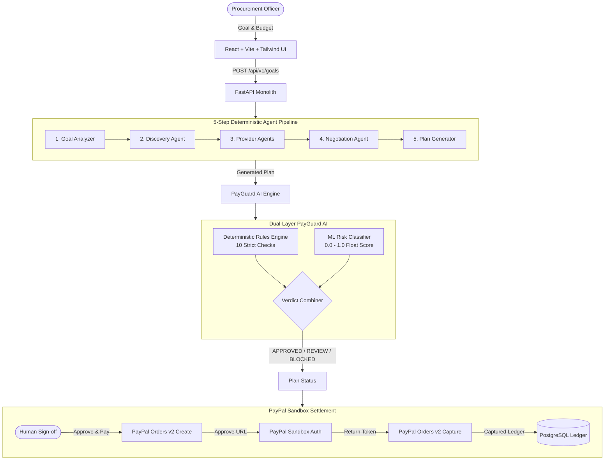

# PayPilot AgentOS + PayGuard AI Architecture

## 1. System Overview

PayPilot AgentOS is an autonomous procurement engine that pairs a multi-step agent pipeline with a deterministic safety and compliance layer (**PayGuard AI**) and **PayPal Orders API v2** settlement.

## 2. Core Modules

### 2.1 Fixed 5-Step Pipeline
The agent pipeline runs as a controlled state machine:
1. **Goal Analyzer**: Extracts needs, budget caps, deadline, and ISO-4217 currency.
2. **Discovery Agent**: Queries verified and candidate providers matching needed capabilities.
3. **Provider Agents**: Simulates provider pricing strategies and concessions.
4. **Negotiation Agent**: Executes iterative discount rounds within provider concession limits.
5. **Plan Generator**: Synthesizes the optimal cost-quality provider bundle into an executable plan.

### 2.2 PayGuard AI Decision Engine
A dual-layer verification gate evaluated before any money moves:
- **Deterministic Rules**:
  - `BUDGET_CAP`: Plan total &le; Goal budget
  - `TXN_LIMIT`: Plan total &le; Max transaction limit ($10,000 / ₹1,000,000)
  - `VERIFIED_PROVIDER`: All providers must be verified (KYC/KYB)
  - `CURRENCY_MATCH`: Standard ISO-4217 currency validation
  - `NO_DUPLICATE`: Idempotency safeguard preventing double billing
  - `PRICE_FLOOR`: No line item below provider minimum cost floor
  - `TOTAL_INTEGRITY`: Strict sum check over line items
  - `GOAL_ALIGNMENT`: Deliverables strictly match declared needs
  - `ML_RISK`: Machine learning risk score (< 0.40 = PASS, 0.40 - 0.70 = REVIEW, > 0.70 = BLOCK)
  - `SINGLE_VENDOR_SHARE`: Flags vendor concentration (> 70% = REVIEW)

### 2.3 PayPal Orders v2 Sandbox Integration
- Server-to-server OAuth token generation with in-memory caching
- Orders API v2 order creation with `CAPTURE` intent
- Return handler with mount-once capture idempotency
- Ledger recording of PayPal Order ID, Capture ID, amount in minor units, and timestamp.
